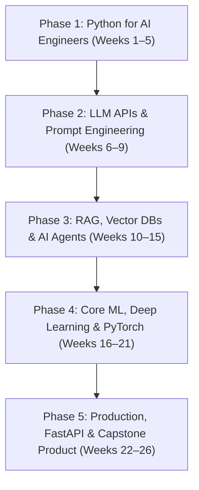

# Personalized AI Engineering Roadmap & Preparation Guide

**Profile & Pace:** Complete Beginner $\rightarrow$ Job & Product-Ready AI Engineer (10–15 hrs/week)  
**Hardware:** ASUS TUF A15 | NVIDIA GeForce RTX 4050 (6 GB VRAM) | 8 GB DDR5-4800 RAM (Windows)  
**Workspace:** `c:\Users\joshb\Desktop\AI-Engineer`

---

## 1. Your Hardware Assessment & Optimization Strategy

Here is where your ASUS TUF A15 stands:
- **Installed & Ready:** `Git 2.55.0` and `NVIDIA Driver 592.00` (RTX 4050 6 GB VRAM detected).
- **Setup Track:** `uv` (modern Python package manager), `Python 3.12`, and `Ollama` (for local models in Phase 2).

> [!IMPORTANT]
> **How to Manage 8 GB System RAM + 6 GB GPU VRAM**
> Your **RTX 4050 (6 GB VRAM)** is awesome for a beginner—it has dedicated Tensor Cores and CUDA support, meaning it can run 1.5B to 4B parameter local LLMs (`Llama 3.2 3B`, `Qwen 2.5 3B`, `Phi-4-mini`) and local embedding models fast.
> However, **8 GB of Windows system RAM** is tight if you run heavy tools simultaneously. Follow these three rules so your laptop never slows down:
> 1. **Skip Anaconda:** Do **not** install Anaconda/Conda—it eats gigabytes of disk and RAM. We will use **`uv`**, a blazingly fast, lightweight Rust-based Python manager that installs Python and packages in seconds with almost zero memory overhead.
> 2. **Cloud-First for Big Models & Training:** Use free cloud APIs (**Google Gemini API Free Tier**, **Groq Free Tier**) for 70B+ frontier models, and **Google Colab / Kaggle (free T4 GPUs with 16 GB VRAM)** when training or fine-tuning PyTorch models in Phase 4.
> 3. **Future \$25 Upgrade (Optional):** Your ASUS TUF A15 has a second empty SO-DIMM DDR5 slot. Whenever budget allows down the road, adding a single **8 GB or 16 GB DDR5-4800 laptop RAM stick** (~\$20–\$40) will double/triple your RAM and unlock dual-channel speed for Docker and heavy local vector databases.

---

## 2. The "Applications-First" Learning Architecture

Traditional paths force you to study calculus and linear algebra for a year before building anything useful. Modern **AI Engineering** flips this: you learn **Python fundamentals**, immediately build **real AI applications with LLM APIs, RAG, and Agents**, and *then* peel back the curtain into **Machine Learning & Deep Learning (PyTorch)** once you can already ship working software.

---

## 3. Step-by-Step Curriculum (10–15 Hours / Week)

### Phase 1: Python Foundations for AI (Weeks 1–5)
*Goal: Go from zero coding experience to comfortably reading/writing Python scripts, handling JSON data, and calling web APIs.*

| Week | Core Topics | Hands-On Mini-Project |
| :--- | :--- | :--- |
| **Week 1** | Variables, data types (`str`, `int`, `float`, `bool`), `if/else`, loops (`for`, `while`), terminal basics | Build an interactive CLI Expense & Study Tracker |
| **Week 2** | Lists, Dictionaries (crucial for AI APIs!), Sets, Tuples, String formatting (`f-strings`) | Build a Quiz Engine that scores answers and tracks stats |
| **Week 3** | Functions, parameters, return values, scopes, error handling (`try/except`), reading/writing `.txt` & `.json` files | Persistent Task Manager that saves/loads state from JSON |
| **Week 4** | Modules, virtual environments (`uv`), `pip` packages, HTTP requests (`httpx`/`requests`), environment variables (`.env`) | Live Weather & Crypto/News CLI fetcher using public REST APIs |
| **Week 5** | Object-Oriented Programming (Classes) & **Pydantic** (type validation used everywhere in AI Engineering) | Structured Data Validator & API Response Parser |

---

### Phase 2: LLM Engineering & Structured Outputs (Weeks 6–9)
*Goal: Connect Python to frontier AI models (Cloud & Local) and build apps that return reliable, structured data instead of just raw chat text.*

- **Week 6: Your First AI Calls (Cloud & Local)**
  - Set up free API keys (**Google AI Studio / Gemini API** & **Groq**).
  - Install **Ollama** on your RTX 4050 to run `qwen2.5:3b` and `llama3.2:3b` locally offline.
  - Understand tokens, system prompts, temperature, context windows, and streaming responses.
- **Week 7: Prompt Engineering & Conversation Memory**
  - Few-shot prompting, Chain-of-Thought reasoning, managing `messages` history arrays in Python.
- **Week 8: Structured Outputs with Pydantic**
  - Force LLMs to return guaranteed JSON schemas (e.g., extracting resumes, invoices, or action items into Python objects).
- **Week 9: Phase 2 Portfolio Project — Smart Document & YouTube Summarizer UI**
  - Build an interactive web app using **Streamlit** or **Gradio** where users paste a link/document and get structured summaries, flashcards, and action items.

---

### Phase 3: RAG (Retrieval-Augmented Generation) & AI Agents (Weeks 10–15)
*Goal: Build AI systems that know your private data (PDFs, codebases, docs) and can take autonomous actions using tools.*

- **Weeks 10–11: Embeddings & Vector Databases**
  - How text becomes numbers (embeddings) and semantic similarity search (cosine similarity).
  - Chunking strategies, metadata filtering, and storing vectors locally using **ChromaDB** or **SQLite-vec** (lightweight on 8 GB RAM).
- **Week 12: Production RAG Pipeline**
  - Hybrid search (keyword + semantic), re-ranking, and citation generation so the AI never hallucinates without citing sources.
- **Weeks 13–14: Tool Calling & AI Agents**
  - Give LLMs Python functions as "tools" (web search, calculator, database lookup, file writer).
  - Build multi-step agent loops (ReAct pattern) and state graphs using **LangGraph** or **PydanticAI**.
- **Week 15: Phase 3 Portfolio Project — Autonomous Research & Knowledge Assistant**
  - An AI agent that searches both your local PDF knowledge base and the live web, verifies facts, and writes a cited report.

---

### Phase 4: Core Machine Learning & Deep Learning (Weeks 16–21)
*Goal: Understand how models actually work under the hood, train classical ML models, build neural networks in PyTorch, and fine-tune open-source LLMs.*

> [!TIP]
> In this phase, you will use your local **RTX 4050** for learning PyTorch tensor operations and small neural nets, and **Google Colab (Free T4 GPU)** for fine-tuning 7B–8B parameter models with LoRA/QLoRA.

- **Weeks 16–17: Data Manipulation & Classical ML**
  - `NumPy` arrays, `Pandas` DataFrames, data visualization (`Matplotlib`).
  - `Scikit-Learn`: Linear/Logistic Regression, Decision Trees, Random Forests, XGBoost, train/validation/test splits, precision/recall.
- **Weeks 18–19: Deep Learning & PyTorch Fundamentals**
  - Tensors on GPU (`device="cuda"` on your RTX 4050!), automatic differentiation (`autograd`), loss functions, optimizers (AdamW), and building a neural network from scratch.
- **Weeks 20–21: Transformers, Hugging Face & Fine-Tuning (LoRA / QLoRA)**
  - How the Transformer architecture (`Attention`) works.
  - Using Hugging Face `transformers` & `datasets`.
  - Fine-tuning a small open-source LLM (`Unsloth` on Google Colab) on a custom dataset and exporting it to GGUF to run locally on your RTX 4050!

---

### Phase 5: Production APIs, Evals & Capstone Product (Weeks 22–26)
*Goal: Turn scripts into deployable products, evaluate AI reliability, and build a flagship portfolio project for jobs/clients/startup launch.*

- **Week 22: FastAPI & Async Python** — Wrap your AI agents and ML models into production REST APIs with streaming endpoints.
- **Week 23: AI Evaluations (Evals) & Guardrails** — Test prompts systematically (`LLM-as-a-judge`), prevent prompt injection, and track latency/cost.
- **Weeks 24–26: Flagship Capstone Project + Deployment** — Build, deploy (Render / Hugging Face Spaces / Railway), and document a full-stack AI product on GitHub.

---

## 4. Day-1 Preparation Checklist (Hands-On Setup)

- [ ] **Stage 1:** Install `uv` and `Python 3.12` via terminal
- [ ] **Stage 2:** Initialize your `c:\Users\joshb\Desktop\AI-Engineer` project workspace with `uv init` and a virtual environment (`.venv`)
- [ ] **Stage 3:** Configure Git (`git init`) and run your first Python script (`Week 1, Lesson 1`)

---

## 5. How We Will Work Together

You can use me as your **personal AI Engineering tutor and pair programmer**:
- **Interactive Lessons:** For every module, I will teach you one concept at a time with short, runnable code examples.
- **No Copy-Paste Trap:** Instead of writing all the code for you, I will give you small coding challenges, review your code, explain errors in plain English, and help you build muscle memory.
- **Project Coaching:** Every week ends with a practical script or app you can push to GitHub.
